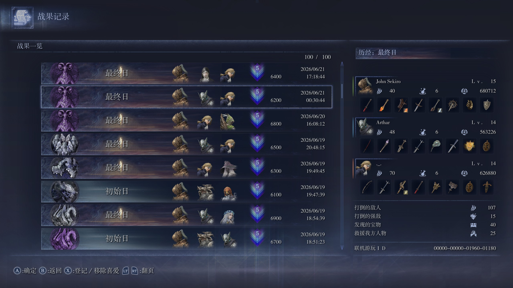

# NR Expedition Analyzer

A small Python toolchain for analyzing Elden Ring Nightreign expedition history.
It recognizes expeditions from screenshots, stores information in YAML for easy editing, and generates a single web report with charts and a table.

## What It Does

- Reads screenshots from `screenshots/`.
- Recognizes each expedition's nightlord, day progress, team, points, and date.
- Writes/updates `results.yaml`.
- Generates `web/index.html` for browsing statistics and expedition details.

## Requirements

- Windows, macOS, or Linux
- Python 3.10+

Install dependencies:

```bash
pip install -r requirements.txt
```

## Quick Start

1. Put your expedition history screenshots into `screenshots/`. Example screenshot:
   
2. Run recognition:

   ```bash
   python scripts/recognize.py
   ```

3. (Optional) Open `results.yaml` and edit user-facing fields like `excluded`, `status`, and `note`.
4. Generate the webpage:

   ```bash
   python scripts/generate_webpage.py
   ```

5. Open `web/index.html` in your browser.

## Input and Output

- Input screenshots: `screenshots/`
- Intermediate data: `results.yaml`
- Cropped row images: `web/crops/`
- Final report: `web/index.html`

## Options

### `recognize.py`

```
usage: recognize.py [-h] [-n N] [--hide-date]

Recognize expeditions from screenshots.

options:
  -h, --help   show this help message and exit
  -n N         Number of screenshots to process (default: all).
  --hide-date  Hide expedition's date in cropped images and generated webpage.
```

### `results.yaml`

The `results.yaml` file contains a list of recognized expeditions. For example:

```yaml
- nightlord: Libra-everdark
  day: day3-victory
  team:
    - Executor
    - Undertaker
    - Duchess
  points: 6400
  date: 2026/06/21 17:18:44
  image: example_0.jpg
  excluded: false
  status: victory
  note:
- nightlord: Libra-everdark
  day: day3
  team:
    - Executor
    - Wylder
    - Duchess
  points: 6200
  date: 2026/06/21 00:30:44
  image: example_1.jpg
  excluded: false
  status: defeat
  note:
# ... and more
```

Each expedition has the following customizable fields:

- `status`: Can be `victory`, `defeat`, `quit`, `disconnected` or `invalid`. This basically only affects the labels and colors in the table and charts. By default, it's set to `victory` if a "final day with victory" is detected from the screenshot, otherwise `defeat`.
- `note`: A free-form text field for user notes. It will be displayed in the table and can be used to add additional information about the expedition.
- `excluded`: Can be `true` or `false`. If `true`, the expedition is excluded when generating the webpage.

When the recognition script is run, it will update the existing `results.yaml` file with the recognized information while preserving the user-customized fields.

## Other Languages

This toolchain only supports Simplified Chinese. To adapt it to another language, follow these steps:

1. Replace the `assets/days/` icons with the corresponding icons in the target language. Note that the icons are assumed to be cropped from a 2560-width screenshot, so if your screenshot is in a different resolution, you need to scale it to 2560 width first before cropping the icons. Example:

   

2. Edit `translations.yaml` to provide translations for the webpage.

## Notes

- This tool is intended to work with 16:9 screenshots. Other aspect ratios are not guaranteed to work.
